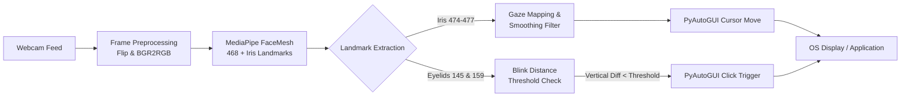

# 👁️ Real-Time Eye Tracking & Blink-Controlled Mouse System

[](https://www.python.org/)
[](https://opencv.org/)
[](https://developers.google.com/mediapipe)
[](https://pyautogui.readthedocs.io/)
[](LICENSE)

An intelligent, hands-free Human-Computer Interaction (HCI) system that transforms standard webcam video into real-time mouse navigation and click interactions using computer vision and deep learning facial landmarks.

---

## 📌 Overview

This project implements a touchless cursor controller powered by **Google MediaPipe Face Mesh** and **OpenCV**. By capturing facial and ocular landmarks in real time, the system translates subtle iris gaze movements into smooth on-screen cursor trajectories, with automatic blink detection for left-click triggering.

Designed with **assistive accessibility** and **contactless interaction** in mind, it provides an intuitive bridge for users with motor impairments or those working in sterile environments (e.g., medical operating rooms).

---

## ✨ Key Features

- **🎯 Sub-Millimeter Iris Tracking**: Utilizes MediaPipe's refined 468+ 3D face mesh and 10 iris landmark points for micro-movement detection.
- **⚡ Real-Time Hands-Free Navigation**: Maps eye coordinates directly or relatively to your screen resolution via PyAutoGUI.
- **👁️ Natural Blink-to-Click**: Calculates vertical eyelid displacement between upper and lower landmarks (`159` & `145`) to trigger intentional left-clicks.
- **🛡️ Debounce & Cooldown Logic**: Incorporates temporal thresholding to differentiate natural involuntary blinks from deliberate click commands.
- **📈 Motion Smoothing & Sensitivity Scaling**: Employs exponential moving filters to dampen jitter and optimize responsiveness.
- **🧪 Quantitative Benchmark Harness**: Includes a dedicated Tkinter evaluation app (`test.py`) that captures empirical reaction time and pixel accuracy metrics into CSV.

---

## 🏗️ System Architecture



---

## 🔬 How It Works

### 1. Iris & Eye Landmark Mapping
The system leverages MediaPipe Face Mesh with `refine_landmarks=True`, extracting:
- **Right Eye Gaze Reference**: Landmarks `474` through `477` (with landmark `475` providing the focal center).
- **Left Eyelid Blink Reference**: Superior eyelid landmark `159` and inferior eyelid landmark `145`.

### 2. Relative Motion & Smoothing
To prevent jerky cursor jumps caused by slight head movements:
$$\Delta X = (X_{current} - X_{prev}) \times \text{sensitivity} \times \text{smoothing}$$
$$\Delta Y = (Y_{current} - Y_{prev}) \times \text{sensitivity} \times \text{smoothing}$$

### 3. Deliberate Click Detection
When vertical eyelid distance drops below the calibrated pixel threshold (`< 5px`), a click event is dispatched with an intentional cooldown (default: `1.0s`) to prevent accidental double-clicks.

---

## 📊 Empirical Evaluation & Benchmark

The project includes an empirical validation tool ([`test.py`](test.py)) built with Tkinter. It projects randomized targets across the display and measures:
1. **Acquisition Latency**: Time elapsed from target spawn to registered click.
2. **Target Offset Distance**: Euclidean distance error in pixels between cursor center and target position.

All rounds are automatically appended to [`eye_tracker_results.csv`](eye_tracker_results.csv) for statistical analysis.

### Sample Benchmark Results
| Metric | Observed Range | Average Performance |
| :--- | :---: | :---: |
| **Response Latency** | 1.05s – 3.33s | **~1.58 seconds** |
| **Target Precision Error** | 0 – 26 pixels | **~10.8 pixels** |
| **Inference Frame Rate** | 30 – 60 FPS | **Real-time (Low Latency)** |

---

## 📂 Project Structure

```text
eye_tracking/
├── .gitignore               # Ignored cache, venv, and IDE files
├── LICENSE                  # MIT License
├── README.md                # Comprehensive documentation
├── requirements.txt         # Python package dependencies
├── eye_tracker_results.csv  # Empirical benchmark datasets
├── main.py                  # Primary real-time eye-controlled mouse script
├── temp.py                  # Calibrated tracker with smoothing & cooldown
└── test.py                  # Fullscreen Tkinter accuracy & latency benchmark
```

---

## 🚀 Getting Started

### Prerequisites
- Python 3.9, 3.10, 3.11, or 3.12
- A functional webcam

### 1. Clone the Repository
```bash
git clone https://github.com/haritejakanchanam-bit/real-time-eye-tracking.git
cd real-time-eye-tracking
```

### 2. Create and Activate Virtual Environment
```bash
# Windows (PowerShell)
python -m venv .venv
.\.venv\Scripts\Activate.ps1

# Linux / macOS
python3 -m venv .venv
source .venv/bin/activate
```

### 3. Install Dependencies
```bash
pip install -r requirements.txt
```

### 4. Run the Eye Tracker
```bash
python main.py
```
> **Tip:** You can also run `python temp.py` to test relative cursor smoothing and sensitivity controls.
> - Press **ESC** at any time to exit the application window.

### 5. Run the Accuracy Benchmark
```bash
python test.py
```
- Click through the spawned targets to evaluate your speed and accuracy.
- Results will be logged directly to `eye_tracker_results.csv`.

---

## 💡 Practical Applications

- ♿ **Assistive & Accessibility Tech**: Enables computing access for individuals with ALS, quadriplegia, or physical motor challenges.
- 🏥 **Sterile Medical Interfaces**: Touch-free display navigation for surgeons and clinicians in operation theaters.
- 🎮 **Gaming & Hands-Free Interaction**: Secondary gaze input for simulation and immersive virtual environments.
- 🔬 **User Experience (UX) & Heatmapping**: Gaze dwell-time research and behavioral interaction studies.

---

## 🔮 Future Enhancements

- [ ] Dual-blink differentiation (left blink for left click, right blink for right click).
- [ ] Dwell-time clicking (click triggered by fixating gaze on a single region for $N$ milliseconds).
- [ ] Adaptive calibration wizard to accommodate different screen sizes and user seating distances.
- [ ] PyQt / Modern UI overlay with real-time sensitivity sliders.

---

## 👨‍💻 Author

**Kanchanam Hari Teja**
- 🐙 GitHub: [@haritejakanchanam-bit](https://github.com/haritejakanchanam-bit)
- 💼 LinkedIn: [Kanchanam Hari Teja](https://www.linkedin.com/in/)
- 📧 Email: [haritejakanchanam@gmail.com](mailto:haritejakanchanam@gmail.com)

---

## 📄 License

This project is licensed under the MIT License - see the [LICENSE](LICENSE) file for details.
